<div align="center">

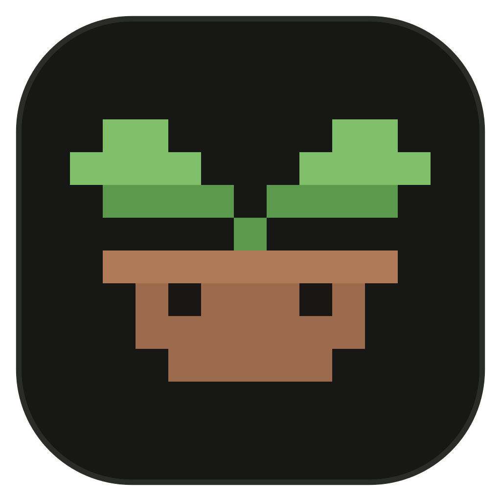

# Graft

**Your code. Your models. Your rules.**

An open-source desktop AI coding agent and chat that works with your choice of models. Graft can edit code, run checks, show diffs and rewind changes. Bring your own provider keys or use local models, set permissions, and connect tools through MCP.

**[Download for Windows or Linux](https://github.com/itzdexy/GraftCode/releases/latest)** · [See screenshots](#a-look-around) · [Install and first run](#install) · [Build from source](#build-from-source)

<sub>Windows installers are not yet code-signed. macOS currently requires a source build. Third-party model providers may charge for API usage.</sub>

[](https://github.com/itzdexy/GraftCode/releases/latest)
[](https://github.com/itzdexy/GraftCode/releases)
[](LICENSE)


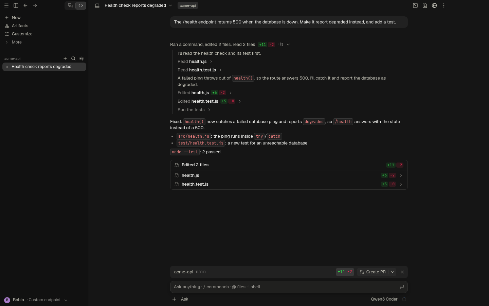

</div>

## What Graft does

- **Works in your project.** It reads the code, edits files, runs your tests and commands, and reports what it changed and how it checked. Every turn is checkpointed, so you can rewind the files, the conversation or both.
- **Runs on your keys and your models.** No subscription and no lock-in: pick any of 200+ providers, point it at an OpenAI-compatible endpoint, or use models running on your own computer.
- **Asks before it acts, until you say otherwise.** Five permission modes, from approving each edit to running on its own, with allow, ask and deny rules per project.
- **Finishes long tasks.** Turns run until the work is done. Taproot mode plans with a task list it has to complete, verifies with your tests and builds, and reviews its own diff before it reports.
- **Checks its own work.** Tell Graft your project's checks (type check, lint, tests) and it runs them after every change. When one fails, the agent reads the output and fixes the cause, up to two rounds.
- **Splits work between agents.** A task that divides runs as a group: explorers side by side, then an implementer, a tester and reviewers, each with its own context and model. The Agents panel shows the group as a live graph, and every agent can be opened or stopped.
- **Keeps going until it is done.** Give a mission an objective and the commands that must pass. Graft works turn after turn, keeps a notebook, and only your commands decide when it is finished.
- **Runs untrusted code in a sandbox.** Turn on the sandbox for a project and its commands run in a Docker or Podman container: only the project folder is shared, and your files, keys and credentials stay out of reach.
- **Tests what it builds.** The agent opens your dev server in the built-in browser, clicks through it like a person, reads the console and takes screenshots.
- **Builds websites.** Describe a site in the Sites tab and Graft designs and builds it, as a React and TypeScript project or as plain files, then hosts it on your computer with a live preview.
- **Makes the pictures too.** Ask for images and Graft generates them with an image model from your provider, or with your own ComfyUI.
- **Works with the apps you build with.** One-click integrations for Blender, Roblox Studio, Unity, Godot, Figma, a Playwright browser, GitHub, Sentry, Linear, Notion, Context7 and Ghidra, plus any MCP server.
- **Stays out of your way.** A command palette for everything, `!` to run a shell command from the message box, `↑` for earlier messages, and `/commit`, `/pr` and `/review` when you want them.
- **Chats too.** Web search with cited sources, files to download, a JavaScript sandbox for calculations, read aloud, and incognito chats that never touch the disk.
- **Keeps your data yours.** Keys are encrypted with your system keyring, and Graft asks providers not to train on your conversations.

### Model metadata and coding workspace (0.6.14)

Settings → Providers → Model catalog refreshes metadata without an application
update. Automatic refresh defaults to every 24 hours; you can change the interval,
turn it off, or refresh manually. Graft starts with its bundled or last validated
catalog when offline and retains it if a refresh fails. The metadata request sends
no API keys, project files or conversations.

Model lists distinguish public catalog entries, provider discovery, deprecation,
account access failures and temporary outages. A missing entry does not prove
retirement or change your conversation's selected model. Retained unavailable
entries explain the problem and can recover on refresh. Catalog capabilities are
metadata; they do not prove that your account can invoke a model.

Native OpenAI shutdown announcements show their published date. A model whose dated
UTC day has ended is disabled; choose a replacement explicitly. Proxies and missing
entries cannot confirm OpenAI retirement.

Writing group agents and general writing Tasks now work in separate private
checkouts. Successful patches integrate only when their destination revisions still
match. Conflicts retain the private checkout and patch for review, with recovery
details in the Agents panel. This also works for folders without a Git repository.
Ignored dependencies are not copied, and checkouts remain on disk for review.
The optional command sandbox remains separate from worktree isolation.

Code sessions now expose `SemanticCode`: local TypeScript/JavaScript definitions,
references, hover, outlines and per-file diagnostics. It requires a trusted project,
uses the bundled language server, and does not apply semantic edits.

In the Files panel, choose **Edit file** to edit complete UTF-8 text up to 512 KiB.
**Ctrl/Cmd+S** saves only if the disk revision still matches. **Check types**
(Ctrl/Cmd+Shift+M) checks the current TypeScript/JavaScript draft; **F12** opens
the definition at the cursor. Language intelligence requires project trust.
Unsaved drafts are backed up to this device after a short typing pause and appear
under **Unsaved drafts** after reopening the session. The original revision is
retained, so recovery cannot silently overwrite external edits. Backup failures
are shown; wait for **Draft backed up on this device** before relying on recovery.
Recovery copies contain source text in the local session database and are removed
when saved/discarded or when their session is deleted. Splits, completion and
rename/refactoring remain outstanding.

### Motion, response recovery and file tabs (0.6.15)

Files now keeps tabs and their preview/edit modes between session visits. Closing
a tab keeps its unsaved draft available for recovery. **References** (Shift+F12)
and **Symbol info** (Ctrl/Cmd+K, then Ctrl/Cmd+I) query the current trusted
TypeScript/JavaScript draft through the bundled language server.

Shared controls, queues and status transitions use bounded animations.
**Settings → Appearance → Motion → On** enables them; System follows your OS and
Reduced removes animation delays. Completed conversation turns are reused during
streaming to reduce transcript processing work.

Interrupted provider streams preserve partial output and cannot execute unfinished
tool calls. Responses containing repeated model control tokens show endpoint
troubleshooting guidance while preserving the original text. This warning does
not repair an incompatible endpoint's model template or change the selected model.

### A session that reads like a conversation, and edits that check themselves (0.6.17)

Code sessions keep Graft's commentary in view and fold the tool steps between
into one line that opens into a list. A running turn shows a single live line:
the step in progress and the time so far. The eye under the message box, or
**Settings → Appearance → Transcript view**, switches between **Normal**,
**Thinking**, **Verbose** and the earlier one-line **Summary**. Chats are unchanged.

After an edit to a TypeScript or JavaScript file in a trusted project with its
packages installed, the bundled language server checks that file and its errors
come back with the edit's result, so the next step can fix them. The transcript
lists them under the diff. An edit waits at most five seconds for its check, and
a server that fails is left alone for a few minutes instead of holding edits up.
**Settings → Models → Check edits for errors** turns this off. Only the edited
file is checked: a change that breaks another file still surfaces through the
project's checks.

In the same projects `SemanticCode` finds a declaration by its name alone, and
from there every use of it, the classes that implement an interface and the
declaration of a value's type. The answers come from the language server, so an
imported or renamed symbol is followed and two things with one name are told apart.

**Settings** has a search box above its pages, which stand under five headings. A
word finds the setting on whichever page it is; taking it opens that page with the
setting in view.

Diffs mark the changed words inside a line and use syntax colours. API keys,
tokens and passwords in command output, tool output and diffs are covered until
the eye beside them is pressed. This changes what is shown, not what is stored
or sent to the model, and it recognizes common formats only; a change waiting for
your approval is shown as it is. The **Edited files** card of the last turn has
**Undo**, which opens the rewind dialog on **Files only**.

### Large folders, connectors with their own icons (0.6.33)

**Sending in a large folder.** A code session snapshots its folder before each turn, so
**Rewind** can put the files back. In a very large folder (a whole Downloads folder) that
snapshot used to keep your message from showing, and Stop and Delete from working, for as long
as it took. Now the message shows the moment you send it; the snapshot follows, and after 20
seconds it is given up with a note ("No checkpoint for this turn: … took longer than 20 seconds
to snapshot"), and Graft doesn't try that folder again until it restarts. Stop and Delete end
the turn wherever it has got to, the snapshot included. A turn stopped before the model said a
word says **Stopped.** under the message. The message box empties the moment you press Enter, so
messages sent one after another while Graft works all queue, in order; on a slow computer the
second and third used to be lost.

**Connectors you recognize.** An MCP server is shown with the icon of the app it reaches, found
by its name, its address or the command that starts it (Roblox Studio, Blender, Unity, Unreal,
Godot, Figma, GitHub, GitLab, Linear, Notion, Jira, Sentry and others, 57 in all, from the
Simple Icons set), and a server that gives itself a title and an icon over MCP is shown by
those. The details column's **Connectors** card shows the icons of the first four; each row
opens to where the server runs, its version, its tools, **Reconnect** and **Open in Customize**.
Customize, the Integrations gallery and the steps of a turn use the same icons. A
**right-click on the details column** chooses which cards it shows.

The scrollbars are slim and rounded, faint until pointed at or scrolled, and tinted while
dragged. **Open a file** (Ctrl+P) lists only files that match what is typed, so Enter at once
opens the one you meant.

### A details column, 3D models and code colors (0.6.32)

A code session has a **details column** at its right, as the Claude desktop app has one:
**Environment** (this computer, the folder, the worktree and the branch), **Context** (how
much of the window is used, part by part — your messages, replies, tool results, tools, MCP
tools, the system prompt — with the free space and how far automatic compaction is, and
**Compact session**), **Connectors** (each MCP server with its state and **Reconnect** or
**Sign in** when it needs one), **Outputs** (the files the session's tools made), **Background
tasks** (commands and agents still running, with their time) and **Changes** (lines added and
removed, **Review**, **Create PR**). It takes the place of the panels and comes back when they
close; the first button at the top right, or the palette's **Show or hide session details**,
shows and hides it, and it remembers which cards you folded.

**3D models.** A `.glb`, `.gltf`, `.obj`, `.stl`, `.fbx` or `.ply` file opens in the Files
panel as a model on a lit floor: drag to turn it, scroll to come closer, right-drag to move,
switch to wireframe, and play its animations. When a reply names a model file of the folder —
one Blender just exported, say — the turn ends with the model drawn in the conversation.
Models are read from the session's folder only, and a model compressed with Draco or meshopt
gets a sentence saying the preview can't unpack it yet. **Pictures a tool sends back** — a
render from Blender, a capture of Roblox Studio — show as thumbnails on the tool's row and open
large.

Two or more messages typed while Graft works fold into one line, **3 messages queued · Next:
…**, that opens to the list, with **Clear all**. At Max and Taproot a short note says what the
level costs until you close it. **Settings → Appearance → Code colors** picks the theme code is
colored in, one for dark and one for light, each previewed live. The Terminal panel's menu sets
the cursor, **Copy on select** and the scrollback, and clears the terminal; the Changes panel's
menu wraps long lines and can hide changes of whitespace alone.

### Limits that hold, and a replace request (0.6.31)

**Settings → Permissions → Limits for a session, a project or a day** pauses a turn once
the work reaches one of six values you set: the tokens spent in this session, what its
project's sessions have used together, or everything used on this computer today, each in
tokens and in US dollars. Tokens are the ones that cost money, with tokens read from a
provider's cache at a tenth, as they are billed; costs come from published prices and can
differ from your bill. A model with no published price is named once and counted in
tokens. A pause says what was reached and offers to continue, as the limits for one turn
do, and these totals go on counting across turns. A chat belongs to no folder, so it is
never counted against a project.

The **Search** tab of the Changes panel can compose a replace. **Ask Graft to replace the
matches** opens a box; type what the matches should become and press it again: the request
is written into your message box, saying how the search ran and what it found. Nothing is
sent and nothing is replaced by the tab — the change is made as a turn, with its checkpoint
and its diff, so you review it like any other edit.

### Search in files and a page that is checked (0.6.30)

The **Changes** panel has a **Search** tab, and `Ctrl+Shift+H` opens it with the keyboard in
its box and the text you had selected as what to look for. It lists every line of the
project that holds the text, under its file, with the matches marked. What git ignores is
left out, and so is `.git`. Three buttons in the box match case, whole words or a regular
expression, and a fourth opens a field for the files to look in or leave out
(`src/**/*.ts, !**/*.test.ts`). The arrow keys walk from the box down the rows; a line
opens its file in the editor at the match, and the list is as you left it when you come
back. A search lists 2,000 lines at most and says so when there are more. **Send the
results to chat** attaches them to your message, with lines that hold a key covered.

The **Browser** panel checks a page. **Check the page** opens a list under it: text with
too little contrast (the ratio, the two colours and how often the pair is used), pictures
without alt text or that did not load, buttons, links and fields without a name, a field
named only by its placeholder, headings that skip a level, small targets with another
within 24 px, and a layout wider than its window with what sticks out. Press a finding and
the page scrolls to it and draws a box around it. The list is of the page as it is laid
out: choose the phone or tablet width and it checks again, and the headline says how wide
the page was. **Ask Graft to fix these** writes the request into the message box and sends
nothing. The lines are the ones the Web Content Accessibility Guidelines 2.2 draw at
level AA. Where a line can't be drawn the check says so instead of guessing: text over a
picture or a gradient is counted as not judged. It is a check of what can be measured, not
an audit: it does not press keys, read the page aloud or look inside frames.

**Screenshot at phone, tablet and desktop size** sends three pictures of the page to your
message in one press (390, 768 and 1280 px wide), whatever size the panel is. An element
you pick arrives with a picture of itself beside its HTML, for a model that can see.

The agent has the same eyes. Its Browser tool has a `check` action, and `check` and
`screenshot` take a `width`, so it sees a page as a phone lays it out while the panel
stays as it is. The brief of a site and of the browser tester ask for the check at 390
and at 1280 px before the work is called done.

### A side question and livelier motion (0.6.28)

**`/btw`** asks something on the side. Type `/btw` and a question in a session, also
while Graft is working: the answer appears above the message box, written from the
conversation as it stands. It is one request with no tools and it never waits in the
queue. Neither the question nor the answer is added to the conversation, so the agent
does not see them, now or later. Copy the answer or dismiss it; a restart forgets it.
It reads the steps that are finished, not the reply being written at that moment.

Motion has two styles under **Settings → Appearance → Motion style**. **Lively**, the
default, answers what you do with movement you can see: a page you open rises into
place over 300 ms while the sidebar holds still, windows and menus spring open, a
message you send travels up from the message box, and a panel comes in from its edge,
also when it joins panels already open (the Browser panel alone stays put: its page is
laid over it where it was measured). What Graft does by itself (a step joining a
turn, a reply being written) moves as little as before. **Calm** is the motion of
0.6.27: a 150 ms cross-fade and a few pixels of travel. With **Motion** on Reduced, or
a system that asks for less motion, nothing moves in either style.

### Windows and motion (0.6.27)

**Settings** opens as a window over the page you were on. The session underneath stays
as it was and keeps working; `Esc`, the close button or a click beside the window shows it
again. Settings is still part of the history: **Forward** opens it again, and every link
into a settings page works as before.

Changes of view are shown instead of cut. Going to another page or session, a new theme,
palette or accent, and another transcript view cross-fade over 150 ms (the Calm style
since 0.6.28; Lively takes 300 ms and moves the page). The panel column
slides open and shut and the conversation moves aside with it. A session that changes
place in the sidebar travels there, and a task that changes state pops as its list
arrives. All of it follows **Settings → Appearance → Motion**: with Reduced, or a system
that asks for less motion, nothing moves and everything still opens, closes and lands
where it should.

### Review and navigation (0.6.26)

Point at the code instead of describing it. Any line of a diff, in the **Changes** panel
or under an edit in the conversation, shows a **+** in its gutter: write what should
change, and the comment sits under the line. In the editor, `Ctrl+Alt+M` (or the button
above it) comments on the cursor's line or the selected lines. Comments wait above the
message box and go to Graft with your next message, each with its file, its line and the
line of code it is about; **Send comments** sends them by themselves. A `/` or `!` command
goes as typed and leaves them waiting.

`Ctrl+P` opens a file by part of its name, with the files you have open first; `app.ts:42`
opens the editor at that line. `Ctrl+T` finds a function, class or type by name through
the language server Graft already runs, in a trusted TypeScript or JavaScript project.
In the file palette, `>` turns it into the command palette and `@` into the symbol one.

The **Changes** panel has a **Problems** tab: the errors and warnings the language server
reports for the files you have changed, in one list, each opening its file at the
problem. It checks when the tab opens and on **Refresh**, 50 changed files at most, and
names any file it could not check with the reason. **Ask Graft to fix these** writes the
request into the message box and sends nothing.

### Code in the conversation (0.6.25)

A file named in a reply is a link. `src/app.ts:42`, a Windows path, or a bare name that
only one file has opens that file in the Files panel's editor at its line; a name two
files share stays plain. The **Edited files** card has **Open** on every row. A code
block's header names the file it is for (a fence such as `ts src/app.ts`) or its
language, and from a dozen lines on how long it is. A block of more than 40 lines shows
its first 20 until you open it, **Wrap lines** wraps it, and **Copy** always copies all
of it. A one-line shell command has **Type into the terminal**: Graft types the line and
you press Enter. A block with a line break in it is never typed.

`Ctrl+F` finds text in the conversation, marks every match and steps through them with
`Enter` and `Shift+Enter`; the editor and the terminal keep their own find while the
keyboard is in them. Formulas written as `$$…$$`, `\[…\]`, `\(…\)` or `$…$` are set
with KaTeX, which loads the first time a reply has math; `$5 and $10` and `$HOME/$USER`
stay text. A Mermaid block has **Draw this**, which asks for it as a drawn diagram.

### Pictures, drawings and research (0.6.24)

While a picture is being made, a grid of dots stands in for it and a line of dots walks
across it. The finished picture comes into focus, and a click opens it in a viewer with
zoom. An SVG the model writes shows as the drawing once its code is complete; the button
beside **Copy** shows the code again. While Graft searches the web, the line above its
steps counts the websites found so far, and the **Sources** card shows the picture each
page offers for itself. Those pictures are fetched like site icons: public https
addresses only, no cookies, re-encoded before they are shown.

### Diagrams (0.6.23)

Ask for a diagram, or type `/diagram` and what to draw. Graft draws it with the
bundled **diagram-design** skill: architecture, flows, sequences, data models and
forty more kinds, each laid out by hand as one `.html` page with an inline SVG, saved
in `docs/diagrams/` unless you name a place. When the turn ends the diagram is shown
in the conversation, live in a sandboxed frame and scaled to fit. **Open** shows it
large with zoom, **Copy image** puts a picture of it on the clipboard, and **Save as…**
writes a PNG at twice its size or an SVG that stands by itself. The page is an
ordinary file: any browser opens it.

Chats draw diagrams too. A chat reads the skill with its `Skill` tool, saves the page
with its other files, and shows it the same way. **Customize → Skills** lists the
skills that come with Graft; a skill of your own with the same name replaces one.
Reading a skill's own files does not ask for permission.

A diagram needs a model that can take in the skill's instructions (its `SKILL.md`
alone is 30 KB, before the references it names) and write a page of a few thousand
tokens by hand; a small or local model may not manage. The skill's own script checks
need Python 3 and are skipped without it.

The [implementation record](docs/IMPLEMENTATION_STATUS.md) tracks verified changes,
security boundaries and the remaining development milestones.

## A look around

<table>
<tr>
<td width="50%">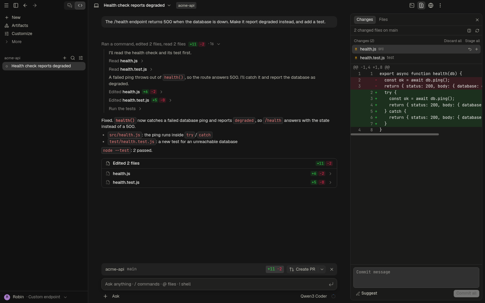<br /><sub>Review each change as a diff, then commit or open a pull request.</sub></td>
<td width="50%">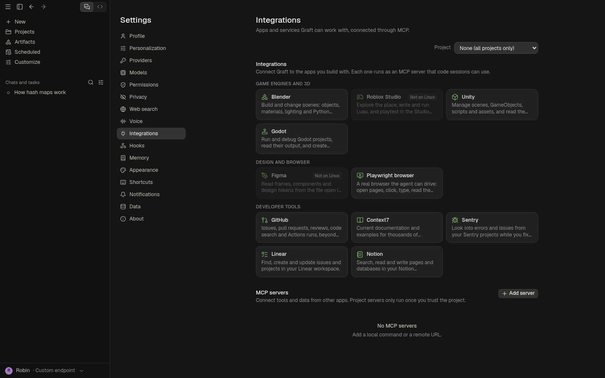<br /><sub>Connect Blender, Unity, Roblox Studio, GitHub and more. (Roblox Studio and Figma need Windows or macOS.)</sub></td>
</tr>
<tr>
<td>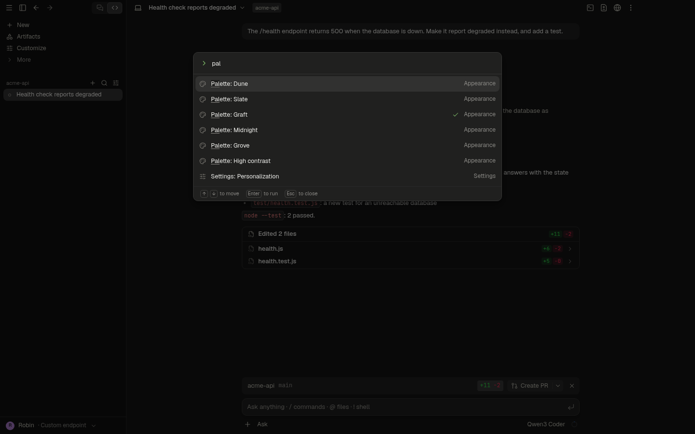<br /><sub>Every action is a few keystrokes away in the command palette.</sub></td>
<td>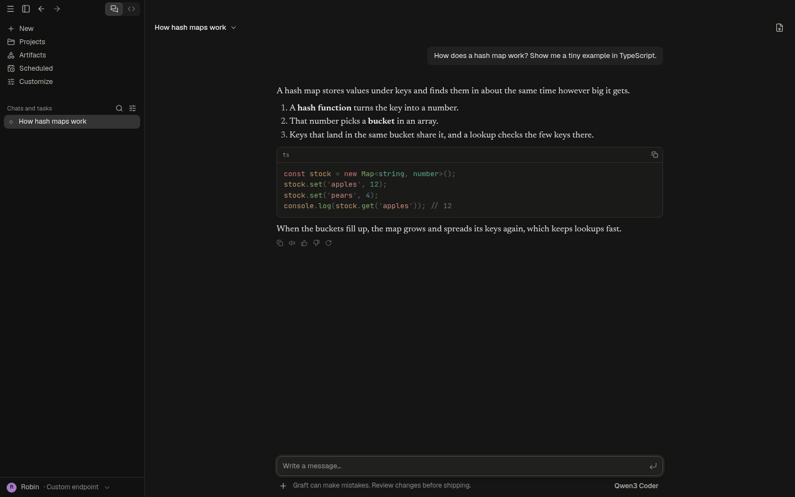<br /><sub>Chats for everything else, with web search, files and a code sandbox.</sub></td>
</tr>
<tr>
<td>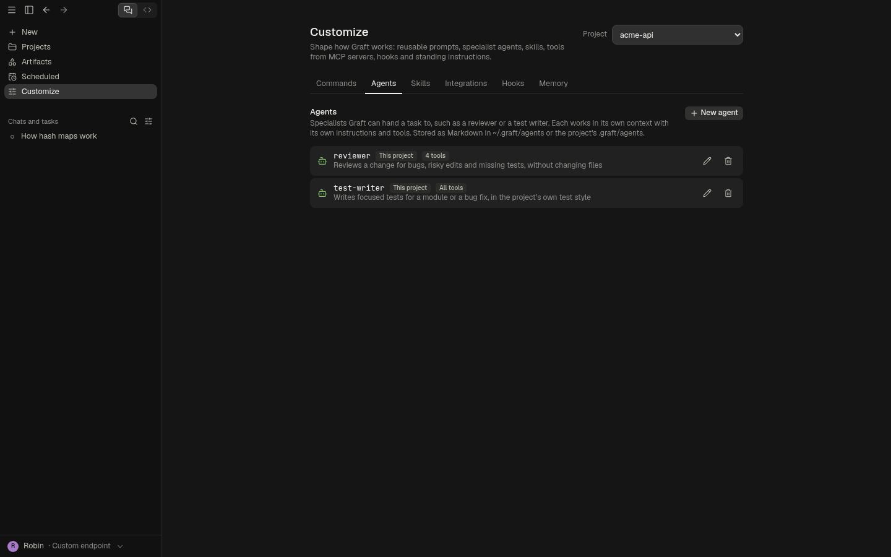<br /><sub>Add specialists such as a reviewer or a test writer.</sub></td>
<td>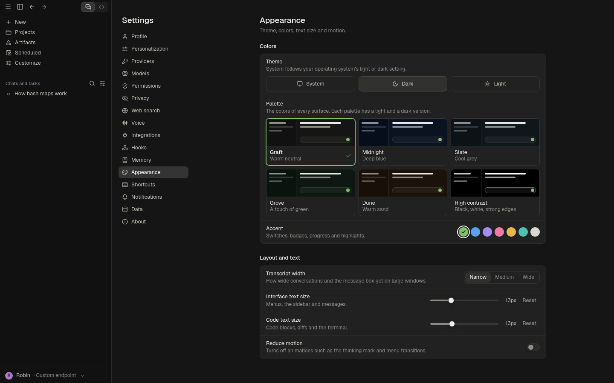<br /><sub>Six palettes, each light and dark, and seven accent colours.</sub></td>
</tr>
<tr>
<td colspan="2">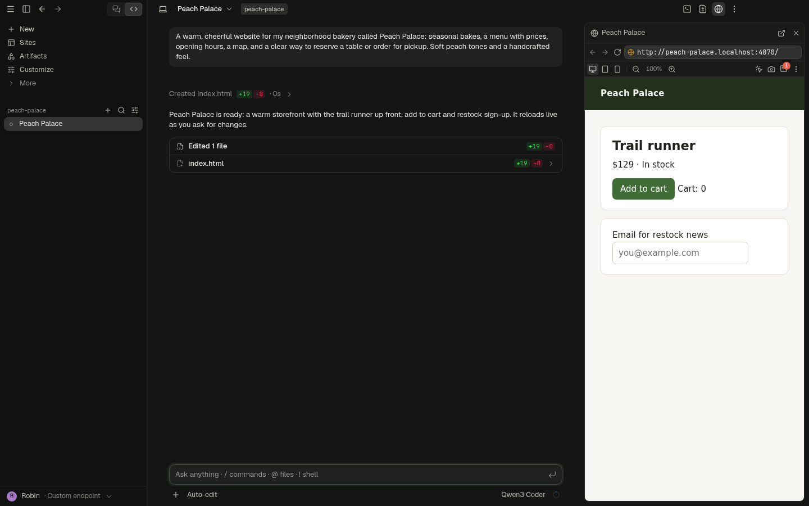<br /><sub>Sites: describe a website, watch it take shape in the live preview, and keep it as a folder you can publish anywhere.</sub></td>
</tr>
<tr>
<td>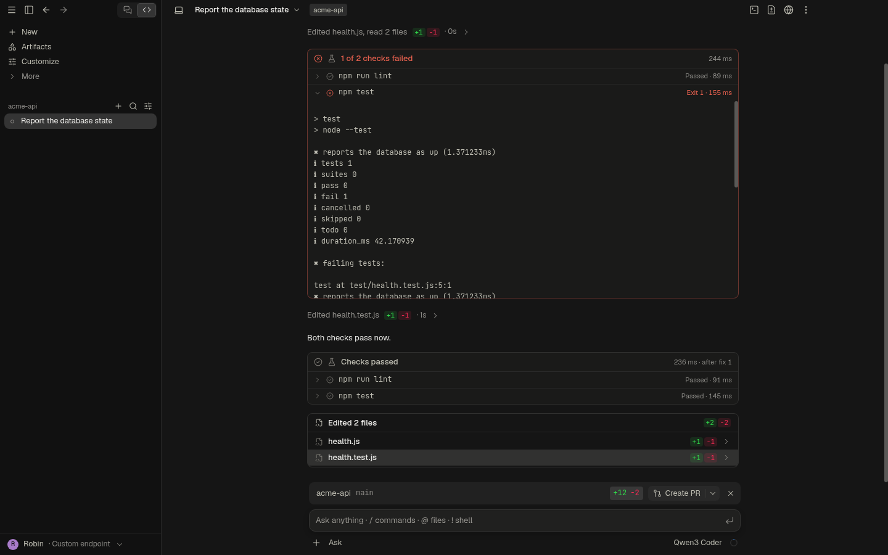<br /><sub>Your checks run after every change; a failure goes back to the agent to fix.</sub></td>
<td>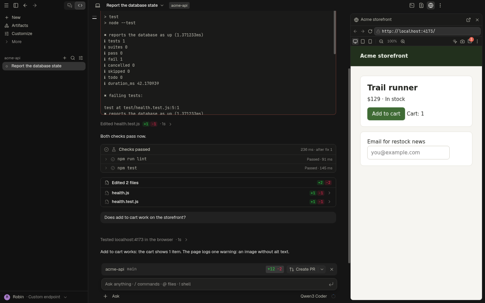<br /><sub>The agent opens your dev server in the browser and clicks through it.</sub></td>
</tr>
</table>

## Install

| Platform | Download |
| --- | --- |
| Windows 10 and 11 (x64) | `Graft-Setup-<version>.exe` from the [latest release](https://github.com/itzdexy/GraftCode/releases/latest) |
| Linux (x64) | The `.AppImage` (mark it executable) or the `.deb` from the [latest release](https://github.com/itzdexy/GraftCode/releases/latest) |
| macOS (Apple silicon) | [Build it from source](#build-from-source) for now with `npm run dist:mac`; ready-made builds return when the release workflow runs again. |

The installers aren't code-signed yet. On Windows, SmartScreen may warn the first time: choose **More info → Run anyway**.

Graft keeps itself up to date: it downloads new versions in the background and asks to restart, or installs them the next time you quit.

## First run

1. **Name and avatar.** Graft greets you by name. The name is never sent to a model in incognito chats.
2. **Pick a provider** from the searchable catalog and paste its API key. Graft checks the key before saving it.
3. **Choose a default model and effort,** then start a chat or open a folder for a code session.

You can add more providers at any time in **Settings → Providers**, and connect other apps in **Settings → Integrations**.

## Features

### Code sessions

- An agent loop with tools to read, write and edit files, search with ripgrep, look up the code's structure, run shell commands (including background commands), fetch pages, search the web, track tasks, and delegate to sub-agents and groups of agents.
- **Groups of agents:** the agent can run a task as a graph of agents with roles (planner, explorer, researcher, architect, implementer, tester, debugger, browser tester, security, performance, UI and final reviewers, documentation). Agents that only read run side by side. An agent that changes files works alone, unless each writer is given its own paths (files, folders or patterns): writers whose paths can't name the same file then work at the same time, each kept to its own paths and reading a file itself before it changes it. Each has a fresh context, the tools of its role, a time limit, an optional token budget, retries after provider failures, and optionally a command that must pass before its work counts. The **Agents panel** draws the graph live; an agent opens to its model and why it was chosen, tools, files, tokens, cost, check, brief, report, failed attempts and steps, and has its own Stop. **Settings → Models → Agents** sets a model per kind of work, or lets Graft send quick reading to the cheapest capable model.
- **Missions:** `/mission` starts an objective Graft keeps working on, turn after turn. You say what done means and which commands must pass; only you set those. The agent keeps a notebook of discoveries, decisions and blockers that is handed back every turn, so it outlives a compacted context. Reporting done runs your commands: a failure goes back to the agent with its output. A mission pauses when you stop a turn, when the agent says it is blocked, when a turn fails, or at its turn limit; it survives a restart, and it can be resumed, stopped and copied as Markdown from the bar above the message box.
- **Code structure:** the `Symbols` tool answers in one step where a name is defined, every file that uses it (tests marked), what imports a file (following `tsconfig` path aliases), which tests cover it, and what a change to it can reach: every file that imports it directly or through others, with the tests among them nearest first. It reads the text with patterns for JavaScript and TypeScript, Python, Go, Rust, Java, Kotlin, C#, C and C++, Ruby, PHP and Swift, so it works on a project that doesn't build.
- **Generated images:** with an image model set up in **Settings → Images** (OpenRouter, OpenAI or Gemini) or your own ComfyUI switched on, the agent makes pictures when you ask for them and saves them in the project; ComfyUI can also run the workflows you saved, including video. It asks first in Ask mode, never overwrites a file unasked, and shows what each picture cost.
- **Fast turns:** the tool calls of one reply run together when they can: neighbouring reads and searches overlap even with an edit among them, and every step still sees the edits before it. A reply that fills the model's context window makes room and carries on instead of stopping.
- **What fills the context:** `/context`, or a click on the context ring, splits the next request into the system prompt, built-in tools, MCP tools, your messages, replies, tool results and reasoning, each with its size. The parts are estimates from the text and say so; the provider's own count is shown beside them.
- **Long sessions:** when the context nears the model's limit, the output of old tool calls goes first: the agent can run a tool again, and the transcript still shows everything. Only when that is not enough is the conversation summarized, and then the latest steps stay exactly as they were, after the summary. The plan you approved and the task list are carried over word for word.
- **Permission modes:** *Ask* (approve edits and commands), *Auto-edit* (edit project files freely), *Plan* (read and plan until you approve; you can edit the plan first, and the approved plan stays above the message box), *Auto* (approve low-risk actions) and *Bypass* (no prompts; only deny rules still block). Bypass has to be switched on in Settings first. Allow, ask and deny rules can be set per user and per project.
- **Edits that land:** an edit has to name one place in the file. When a model gets only the indentation wrong, Graft still finds the block by its text and fits the new lines to the file; with two candidates it asks for more context instead of guessing.
- **Git:** an optional worktree per session, hidden checkpoints before every turn, and rewind for files, the conversation or both. A rewind to before a summary or a `/clear` brings the earlier conversation back for the model. Diff and commit from the app, and open a pull request.
- **A transcript in the style of a terminal agent.** Each turn's work folds into one line, such as "Ran 3 commands, created a.ts, edited 2 files +75 −4 · 2m 50s". A card lists the files the turn changed, each opening to its diff. While a turn runs, a live status line shows elapsed time, context size and background tasks.
- **Panels:** an integrated terminal, a file browser with previews, changes and diffs, text search across the project, a browser for local apps, the agent graph, and background tasks.
- **Files you can see and take:** the Files panel shows pictures (with their size in pixels), plays clips and sound, and highlights text. Each file and folder has a menu, from its … button or a right-click: copy its path or its path in the project, copy a picture itself, show it in its folder, open it with its own app or your editor, or add it to your message. A picture the agent reads shows in the conversation too. Scripts and programs are never opened by a click.
- **A turn that is cut off:** every tool call is written down before it runs and again when it returns. If Graft crashes, is killed or loses power in the middle of a turn, the next start answers each open call with what is known: its recorded result, "outcome unknown, check before repeating", or "not run". A command the app had started is not found again and may still be running; the note says its outcome is unknown.
- **Checks after changes:** in **Customize → Checks**, list the commands that tell whether the project still works; Graft suggests them from `package.json` scripts (with your package manager), Cargo, Go and Python config. They run after any turn that changed files, show live in the transcript, and a failure goes back to the agent with its output and a reminder to fix the cause rather than weaken the check. Checks only run in projects you trust.
- **A browser for developers:** the Browser panel has a console with an error badge, a check of the page (contrast, names, headings, crowded targets, a layout wider than its window), find in page, zoom, phone and tablet widths, developer tools, reload without cache and clearing site data. Pick an element (it comes with its picture), take a screenshot of the page as it is or at three sizes at once, or grab the console, and it lands in your message. With no page open, it lists dev servers running on your computer and in the session's sandbox.
- **The agent tests in the browser:** the Browser tool opens a page, reads it as text plus numbered links, buttons and fields, clicks with real mouse events, types the way frameworks expect, waits for text, reads the console, checks the page for what is hard to read, unnamed or too wide, and takes screenshots, both at any width it asks for. Opening a local dev server needs no approval in Auto-edit; other sites ask.
- **Computer use (Windows, opt-in):** with a model that can see images, the agent can take screenshots, use the mouse and keyboard, zoom in to read small text and open apps by name. Each action asks first unless you allow it for the session. A banner says what it is doing, a ring marks each click, each step shows its screenshot in the chat, and `Ctrl+Alt+Esc` stops it.
- **Project memory:** `GRAFT.md` instruction files, plus `AGENTS.md` and `CLAUDE.md` for compatibility with other tools. Also custom slash commands, skills, hooks and MCP servers.
- **Custom agents:** specialists such as a reviewer, a test writer or a debugger, written as Markdown in `~/.graft/agents` or a project's `.graft/agents` (or from templates in **Customize → Agents**). Graft hands them tasks with their own instructions and context. An agent's tool list can only narrow what the session allows.
- **Shell commands from the message box:** start a message with `!` to run it in the session's shell, for example `!npm test`. The output shows as a terminal card, and Graft sees it with your next message.
- **Commands for everyday work:** `/commit`, `/pr`, `/review`, `/security-review`, `/explain`, `/research`, `/test`, `/decompile` and `/init` send carefully written prompts; `/plan`, `/mission`, `/context`, `/export`, `/system`, `/compact`, `/rewind` and `/new` act on the session; `/btw` asks a side question that stays out of it. A command file with the same name replaces any of the prompt commands.
- **Decompilation:** `/decompile` rebuilds compiled code as source one function at a time: a fresh agent per function, the project's own match check as the judge, a limit on attempts, and no editing of the target or the comparison tools. With the Ghidra integration connected, the agent imports binaries, decompiles functions and follows cross-references there.
- **See what the model sees:** *View system prompt* (session menu or `/system`) shows the exact instructions and tools the next turn sends.

### Sites

The Sites tab builds websites. Describe one (who it's for, the feel, the pages) or start from an idea, and Graft creates a folder for it in **Graft Sites** in your user folder (`C:\Users\you\Graft Sites` on Windows, `~/Graft Sites` elsewhere), starts a session that designs and builds it, and serves it on your computer at its own address, such as `http://peach-palace.localhost:4870/`. The preview sits beside the session in the Browser panel and reloads by itself whenever a file changes, so you watch the site take shape and ask for changes as you go.

- The agent works from a design brief: a clear concept, a real type pairing and palette, a responsive layout from phones to wide screens, real copy instead of placeholder text, accessible details, and a check of its own work in the browser before it reports.
- **React + TypeScript** (the choice a new site starts on when Node.js is installed) makes the site a real project. Graft writes the starter into the folder: `package.json` with exact versions (React 19, Vite 8, TypeScript 5.9), a strict `tsconfig.json`, `index.html`, `src/main.tsx`, `src/App.tsx` and `src/styles/`. The agent is briefed to work the way a careful team does: one component to a `.tsx` file with its props as a named type, what repeats as typed data, styles as tokens and CSS modules, no `any`. It runs `npm install` once and `npm run build` to show a change; the build type-checks first, so a type error stops it and the last good page stays up.
- Graft asks before those commands run, as it does for any command in a session: a build script is code, and code you did not read should not run unasked. Allow one for the session or for the project from the prompt.
- A TypeScript site is served from its `dist` folder and nothing else: sources, packages and settings are not on show, and an address that names no file gets the page, as an app of one page needs. To publish, put `dist` on any static host, or connect the folder to a host that builds (`npm run build`, output `dist`). Its packages take about 70 MB a site.
- **Plain HTML** makes a site of HTML, CSS and JavaScript files with no build and nothing to install; the folder can be published as it is. Sites made before 0.6.29 are plain and stay so. The gallery says which kind each site is.
- The gallery shows every site with a picture of its latest version. Open it, open it in your own browser, show its folder, or delete it (it goes to the Recycle Bin).
- The local server listens on your computer only, answers only for `*.localhost` addresses and never serves hidden files such as `.git` or `.env`.

### Sandbox

A project's commands can run in a container instead of on your computer: the agent's shell commands, its background servers, the project's checks and your own `!` commands. Turn it on from the computer icon in a session's header, the command palette or **Settings → Sandbox**. It needs [Docker Desktop](https://www.docker.com/products/docker-desktop/) (or Docker on Linux) or [Podman](https://podman.io/); on Windows and macOS both run Linux containers in a small virtual machine.

| | |
| --- | --- |
| Shared with the container | The project folder only, at `/workspace` |
| Read-only inside it | `.git` and `.graft`, so nothing can plant a git hook, an fsmonitor command or a Graft hook that would run outside the sandbox |
| Out of reach | Your home folder, other projects, SSH keys, credentials, Graft's keys and your environment variables |
| Network | On by default so installs work, with common dev-server ports forwarded to `localhost`; one switch cuts it off entirely |
| Limits | Memory, CPUs and process count, no extra privileges, dangerous capabilities dropped |
| Dependencies | `node_modules` lives in a per-project volume, so installs in the sandbox never touch your own copy |

In Auto-edit and Auto, sandboxed commands run without asking, because they can only reach the project folder; commands that look dangerous still ask, and your deny rules still apply. The sandbox protects your computer, not the project itself: code in it can still change the project's files, which you review as diffs and can rewind.

### Integrations

Settings → Integrations adds well-known MCP servers in one step. Graft checks what each one needs, shows the setup steps from the project's own documentation, and keeps any token encrypted.

Every tool of a server has a permission of its own (Default, Always ask, Allow, Never), and so does the server as a whole; they are ordinary permission rules, so Settings → Permissions lists them too. A tool's "read-only" label is the server's own word and only a hint. A server started on this computer gets what you choose of its environment: everything, everything except keys, tokens and passwords (what a new server starts with), or only what a program needs to start. None of that is a sandbox: such a server runs as you.

| Integration | What the agent can do | Needs |
| --- | --- | --- |
| Blender | Build and change scenes, materials and lighting, and run Python in Blender | [uv](https://docs.astral.sh/uv/) and the MCP for Blender add-on |
| Roblox Studio | Explore the place, write and run Luau, playtest | Roblox Studio with its MCP server turned on (Windows, macOS) |
| Unity | Manage scenes, GameObjects, scripts and assets; read the console | uv and the MCP for Unity package |
| Godot | Run and debug projects, read their output, create scenes and nodes | Node.js and Godot 4 |
| Figma | Read frames, components and design tokens | The Figma desktop app with its MCP server on (Windows, macOS) |
| Playwright browser | Drive a real browser: open, click, type, read and screenshot pages | Node.js |
| GitHub, Context7, Sentry, Linear, Notion | Work with issues, pull requests, docs and pages | A token or a sign-in |
| Ghidra | Import and decompile programs, follow cross-references and call graphs, rename as it learns | uv, Ghidra and the Java JDK it asks for |

Any other MCP server can be added by hand, for all projects or for one. Graft follows each server as it changes: tools that appear after it connects (Roblox Studio offers them once Studio attaches) show up on their own, long jobs that report progress aren't cut off, and a server that crashes reconnects. Chats can use the apps you connect for all projects, asking before each action.

Graft uses what a server offers beyond tools. What a server says about using itself goes into the prompt, set apart as the server's own words (never as rules). The resources it publishes can be listed and read by the agent, and its prompts appear in the `/` menu as `/mcp__server__prompt`. Results that are only structured data are shown, and a program started on this computer is told which project folders are open (a server across the internet is not). When a setup has more tools than are worth sending with every request (GitHub's alone has dozens), the tools wait: the prompt names the servers, and the agent finds and loads what it needs with a search.

### Chats

- Conversations with attachments and images, and per-chat model and effort.
- **Web search and page reading** without prompts, with sources cited inline as site pills. A page on this computer or your local network is asked about first, and the web cannot redirect Graft into one.
- **Research:** `/research` and a question sends a routine: plan the questions, search, open the pages instead of trusting excerpts, check each claim in a second source, write a report with its sources. A chat can run several researchers side by side, each on one part. A reply that read pages ends with the list of them, and every cited link says whether its page was opened, only found by a search, or neither.
- **Files to download:** chats can create documents, data, code and pictures, shown as cards with Save, Open and Show in folder. Opening is limited to documents and pictures, so a click never runs a script.
- **Real documents:** ask for a PDF, a text document (.docx), slides (.pptx) or a spreadsheet (.xlsx) and Graft builds it from the Markdown or rows the model writes: headings, lists, tables, links, the chat's own pictures, speaker's notes on slides, numbers and formulas in sheets. It is built inside Graft, in a window that runs no script and loads nothing from the web.
- **Code in a sandbox:** chats run JavaScript in a hidden page with no network or file access to calculate, process data and make files.
- **They know the time:** each message carries when it was sent.
- **Commands:** type `/` for the commands a chat can use, such as `/research`, `/context`, `/clear` and `/compact`; `/model` opens the model menu. Commands that work on a project, such as `/plan` and `/commit`, say so here instead of being sent to the model.
- **Read aloud** with pause, resume and stop, in a natural voice from OpenRouter's speech models or your computer's own voice (Settings → Voice).
- **Incognito chats** that are never saved. See [Privacy and security](#privacy-and-security).

### Models and providers

- A catalog generated from [models.dev](https://models.dev) with 200+ providers, plus Ollama and custom endpoints. Each model's context window, tool use, vision, effort levels and prices come from the catalog and the provider's own model list.
- **Context sizes you can trust:** a provider added by typing its address is matched to its catalog entry, a server's own figure for a model wins, and a model on an unknown gateway gets the size most providers give for it. A size nothing vouches for says "(assumed)", and you can set a model's size yourself in Settings → Models. A model on Ollama is measured against the context Graft asks Ollama to hold (32K unless you set a size, shown as "32K of 128K context"), since that is all Ollama keeps; a model Ollama passes on to a hosted service gets its whole window.
- **OpenAI's Responses API** for the models only it serves (the `-pro` and Codex models and deep research): the summary of their reasoning is shown as they think, and the reasoning is kept across tool calls. Tested against recordings of the API, not a live account.
- **Effort levels per model,** from *Off* to *Max*, with *Taproot* on top for code sessions. Each model shows the levels it has: Gemini 3 and later think by named level, as Google's API asks, and earlier Gemini models by a budget.
- **A backup model:** choose one in Settings → Models. When a session's model is overloaded, rate limited or unreachable after its retries, and nothing of a reply has arrived, the turn continues on the backup and says so. A sub-agent, or an agent of a group, whose model fails is finished the same way, and its record names the model that took over. The next turn asks the session's own model first again. Never used in incognito chats.
- Reasoning carried across tool calls for models that need it. Prompt caching for Claude models, both on Anthropic and through OpenRouter. Cost tracking that counts cached tokens at their own rates and uses the charged amount when the provider reports it.
- **Limits for one turn:** in **Settings → Permissions**, pause a turn after a number of steps, tokens, tool calls, retries of failed requests, an estimated cost, or minutes of work. All but the steps count the sub-agents and groups the turn starts; the time spent waiting for your answer doesn't count. The pause names the limit and offers to continue. Cost is an estimate from published prices: a model without one is named when it answers and can't be followed. None is set by default.
- **Usage by day:** **Settings → Usage** adds up what Graft used on each day and with each model: requests, tokens sent (and how much of that the provider read from its cache), tokens written, and the cost, as bars and as a table. A model with no published price is counted without a cost. Counted from 0.6.16 on; incognito chats are left out.

### Personal and good-looking

- **Personalization:** tell Graft what it should know about you and how to respond, and choose a response style: balanced, concise, explanatory or learning. Every chat and code session uses it; incognito chats never do.
- **Needs you:** sessions that wait for an answer or an approval, or stopped with an error, are listed at the top of the sidebar, newest first, and return to their place once answered. The session you have open stays where it is. Desktop notifications for them can play a sound or stay silent (Settings → Notifications); a finished session is quiet either way.
- **Command palette** (`Ctrl+Shift+P`, or `>` in search): start sessions, switch palettes and themes, open any settings page, export, compact, rewind and more, with fuzzy search and your recent commands first.
- **Appearance:** six palettes (Graft, Midnight, Slate, Grove, Dune and High contrast), each in light and dark, seven accent colours, and short, quiet motion. **Motion** follows your system, or is set to On or Reduced for Graft alone.

### Web search engines

| Engine | Needs |
| --- | --- |
| Exa or DuckDuckGo | Nothing: free, with no key or account. Each stands in for the other when it's busy. |
| Brave Search or Tavily | An API key from that service |
| SearXNG | The address of your own instance |
| Anthropic, OpenAI, Google Gemini or OpenRouter | That provider's key in Graft. Billed by the provider; the search runs on its cheapest suitable model, and Claude models on Anthropic search directly. |

*Automatic* uses Brave, Tavily or SearXNG once you set one up, and the free engines otherwise. A provider's paid search runs only when you pick it.

## Privacy and security

- **API keys** are encrypted with the operating system's keyring (Electron `safeStorage`). If no keyring is available, Graft refuses to store keys unless you explicitly opt in. Keys never reach the user interface after you enter them, and they never appear in logs.
- **"Ask providers not to train on my data"** is on by default. OpenRouter then routes only to providers that don't store or train on prompts, and OpenAI requests ask not to store responses. Settings → Privacy shows, for each provider, what Graft can and can't enforce.
- **Incognito chats**
  - live only in memory and are gone when you delete them or quit;
  - never generate a title through a model;
  - leave your name out of the prompt and their text out of system notifications;
  - on OpenRouter, use only providers that keep no data at all.
  
  You can also restrict them to models running on your own computer.
- **The renderer is sandboxed:** `contextIsolation` is on, `nodeIntegration` is off, a strict content security policy applies, and a typed preload bridge is the only way in. Filesystem, shell, git, network and keys all live in the main process.
- File contents, tool output, web pages and MCP output are treated as untrusted and can never change permission rules.
- Destructive commands, such as force pushes, hard resets and recursive deletes, always ask first. The one exception is Bypass mode, which you have to switch on yourself and which can keep these checks ("Keep safety checks in Bypass").
- **The sandbox** (optional, per project) runs commands in a container that sees only the project folder, with `.git` and `.graft` read-only. See [Sandbox](#sandbox).
- **File previews** are served one file at a time through a private address that can't reach the files beside it, under a policy that blocks network access.
- **The Browser panel** runs pages in their own in-memory session with no preload script, every permission denied, downloads blocked and only `http` and `https` allowed. Graft's own page scripts run in an isolated world the page can't see. To lay a page out at another width for a check or a picture, Graft attaches to that one page over the DevTools protocol for the moment it takes and detaches again.

## Keyboard shortcuts

| Action | Shortcut |
| --- | --- |
| New session | `Ctrl+N` |
| Search | `Ctrl+K` |
| Toggle sidebar | `Ctrl+B` |
| Toggle terminal | ``Ctrl+` `` |
| Toggle changes | `Ctrl+Shift+D` |
| Toggle files | `Ctrl+Shift+F` |
| Search in files | `Ctrl+Shift+H` |
| Focus the message box | `Ctrl+L` |
| Find in the conversation | `Ctrl+F` |
| Open a file by name | `Ctrl+P` |
| Go to a symbol by name | `Ctrl+T` |
| Comment for the agent (in the editor) | `Ctrl+Alt+M` |
| Stop the agent | `Esc` |
| Cycle permission mode | `Shift+Tab` |
| Settings | `Ctrl+,` |
| Command palette | `Ctrl+Shift+P`, or `>` in search |

In the message box, `/` lists commands, `@` mentions a file, `!` runs a shell command in a code session, and `↑`/`↓` bring back messages you sent.

On macOS, `Ctrl` is `Cmd`. Every shortcut can be changed in **Settings → Shortcuts**.

## Build from source

You need Node.js 22 or later, and Git.

```bash
npm ci
npm run dev        # run Graft with hot reload
```

| Script | What it does |
| --- | --- |
| `npm run build` | Builds the main process, preload and renderer into `out/` |
| `npm run typecheck` | Strict TypeScript checks for every project |
| `npm run lint` | ESLint with zero warnings allowed |
| `npm test` | Unit tests (Vitest) |
| `GRAFT_LIVE_MCP=1 npx vitest run tests/unit/mcp.live.test.ts` | Starts real MCP servers through Graft's manager and checks the integrations catalogue against npm, PyPI and the remote endpoints (needs the network, Node.js and uv) |
| `npm run test:e2e` | End-to-end tests that drive the built app (Playwright) |
| `npm run test:e2e:docker` | Runs the end-to-end tests in a Linux container, from the working tree (needs Docker) |
| `npm run verify:docker` | Typecheck, lint, unit tests, build and the end-to-end tests in one Linux container, from the working tree; every step runs and `test-results/docker/summary.txt` has each one's exit code (needs Docker) |
| `npm run dist:win` / `dist:mac` / `dist:linux` | Builds installers with electron-builder |
| `npm run dist:linux:docker` | Builds and smoke-tests the Linux installers in a Docker container, from any OS |
| `npm run measure:startup` | Times the first window, the first screen and the quit over several runs of the built app |
| `npm run icons` | Regenerates the app and tray icons from the mascot sprite |
| `node scripts/generate-palettes.mjs` | Regenerates the colour palettes and accents from the neutral tokens |
| `npm run catalog` | Refreshes the provider and model catalog from models.dev |

## Releases and updates

1. Bump `version` in `package.json` and add the release notes to `src/renderer/src/features/home/releaseNotes.json`. The app shows them under "What's new", and the release on GitHub uses the same text.
2. Commit, tag and push:
   ```bash
   git tag v0.3.0
   git push origin main --tags
   ```
3. The **Release** workflow builds the installers on Windows, macOS and Linux, starts each packaged app for a smoke test, and attaches them to a draft release. It publishes the release only when every platform passed. Installed copies then pick up the update automatically.

Running the Release workflow by hand (**Actions → Release → Run workflow**) is a dry run: the same builds and checks, with the installers kept as workflow artifacts.

Without GitHub Actions, build on your own machine and upload the files `electron-builder` wrote to `dist/` (the installer, its `.blockmap` and `latest.yml`; `latest-linux.yml` or `latest-mac.yml` on the other platforms):

```bash
npm run dist:win
node scripts/release-notes.mjs 0.3.0 > notes.md
gh release create v0.3.0 dist/Graft-Setup-0.3.0.exe dist/Graft-Setup-0.3.0.exe.blockmap dist/latest.yml --title "Graft 0.3.0" --notes-file notes.md
```

With Docker, `npm run dist:linux:docker` builds the Linux installers in a container on any OS and writes them to `dist/linux/`; add them with `gh release upload v0.3.0 dist/linux/*`. macOS installers have to be built on a Mac.

> Installed apps read releases without signing in, so the releases must be public for updates to reach users. To ship from your own server instead, build with `GRAFT_UPDATE_URL` set to an HTTPS folder that holds `latest.yml` and the installers.

## Architecture

```
src/
  main/        Electron main process: agent loop, tools, permissions, providers,
               storage (SQLite), git, terminals, MCP, search, updates
  preload/     the typed bridge, the renderer's only way to reach the main process
  renderer/    React UI (Zustand stores, Tailwind tokens, Radix primitives)
  shared/      schemas and IPC contracts (Zod), shared by both sides
resources/     the provider catalog and tray icons shipped with the app
scripts/       the icon generator, the catalog builder, measurement tools
tests/         unit tests (Vitest) and end-to-end tests (Playwright)
```

- Every IPC channel is declared once in `src/shared/ipc/contracts.ts`, and its input and output are validated with Zod on both sides.
- Provider adapters cover Anthropic, OpenAI-style chat completions (OpenAI, OpenRouter and every compatible provider), Gemini and Ollama, all behind one streaming interface.
- Each session runs its own agent loop, so sessions work concurrently. Sessions, settings, agent runs and missions are stored in SQLite with versioned migrations.
- A group of agents is a graph run by a scheduler that knows nothing about models (`src/main/agent/orchestrator.ts`); `agentGroup.ts` turns each node into an agent loop with its role's tools and model. A mission's rules are pure functions (`mission.ts`) that the session carries out.

## Help Graft grow

Try Graft on a real project and [report issues or onboarding friction](https://github.com/itzdexy/GraftCode/issues). Reproducible examples, technical feedback and contributions are welcome.

Maintainers: see the [launch playbook](docs/LAUNCH_PLAYBOOK.md) for demo ideas, outreach drafts, launch readiness and success metrics.

## Acknowledgements

- Model and provider metadata comes from [models.dev](https://models.dev) (MIT License).
- Diagrams are drawn with [diagram-design](https://github.com/cathrynlavery/diagram-design) by Cathryn Lavery (MIT), bundled unchanged.
- Graft is built with [Electron](https://www.electronjs.org/), [React](https://react.dev/), [Vite](https://vitejs.dev/), [Zod](https://zod.dev/), [Radix UI](https://www.radix-ui.com/) and [ripgrep](https://github.com/BurntSushi/ripgrep).

Graft is an independent project. It is not affiliated with or endorsed by any model provider.
